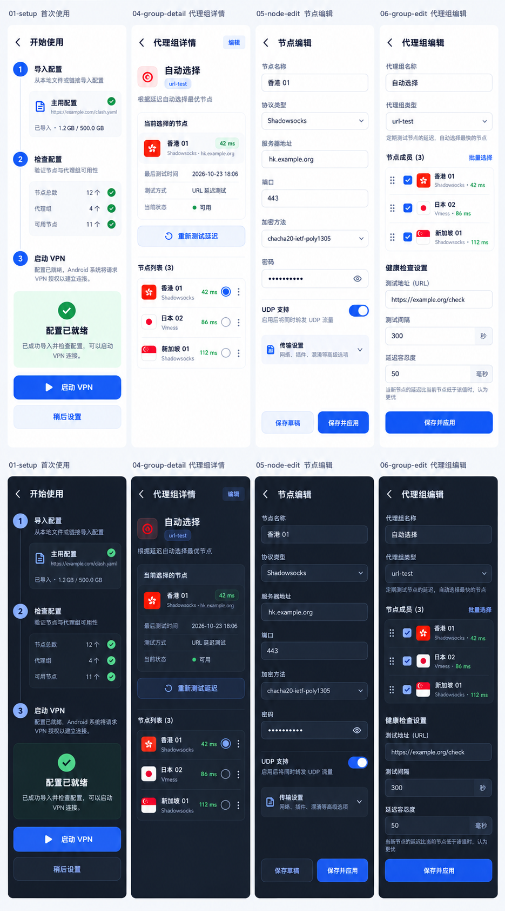
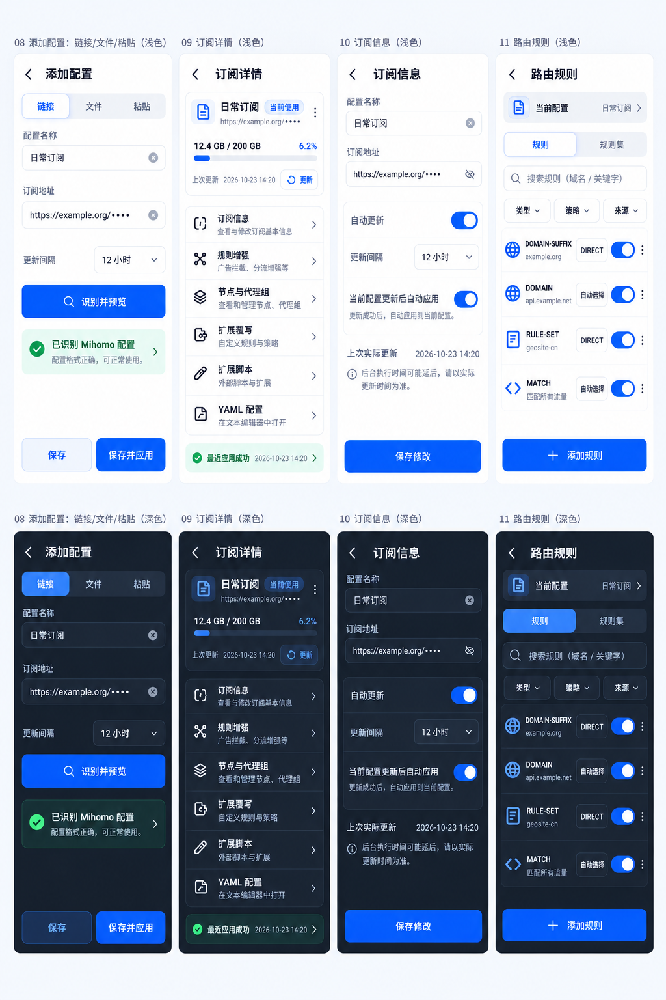
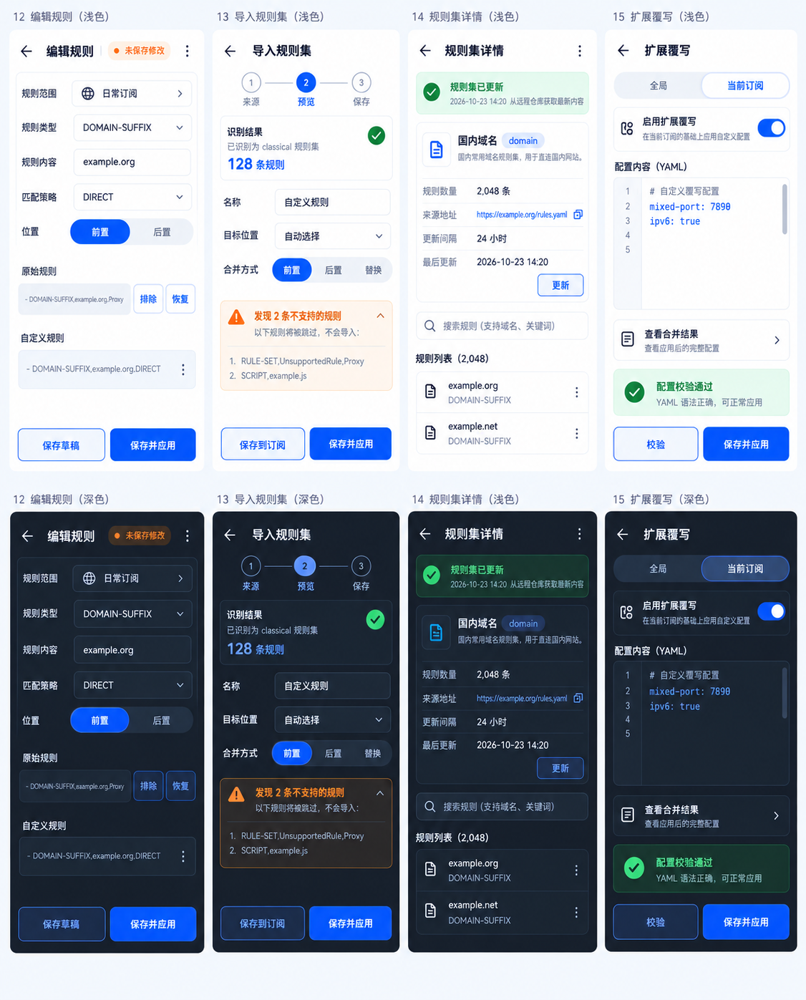
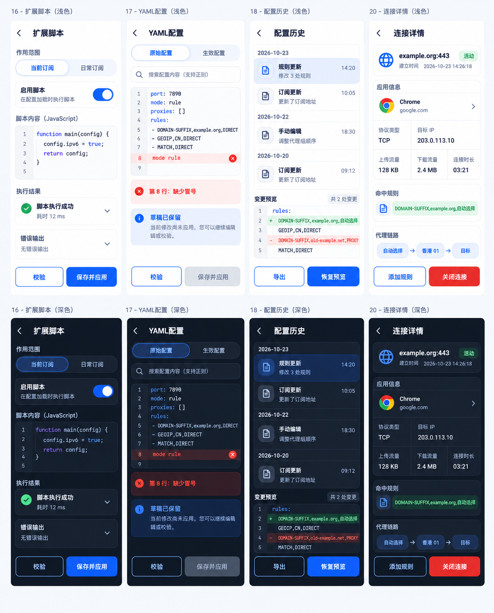
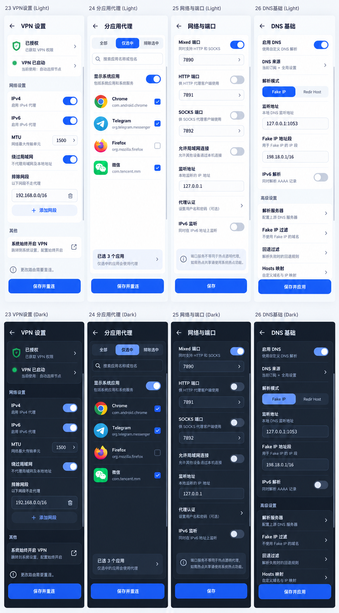
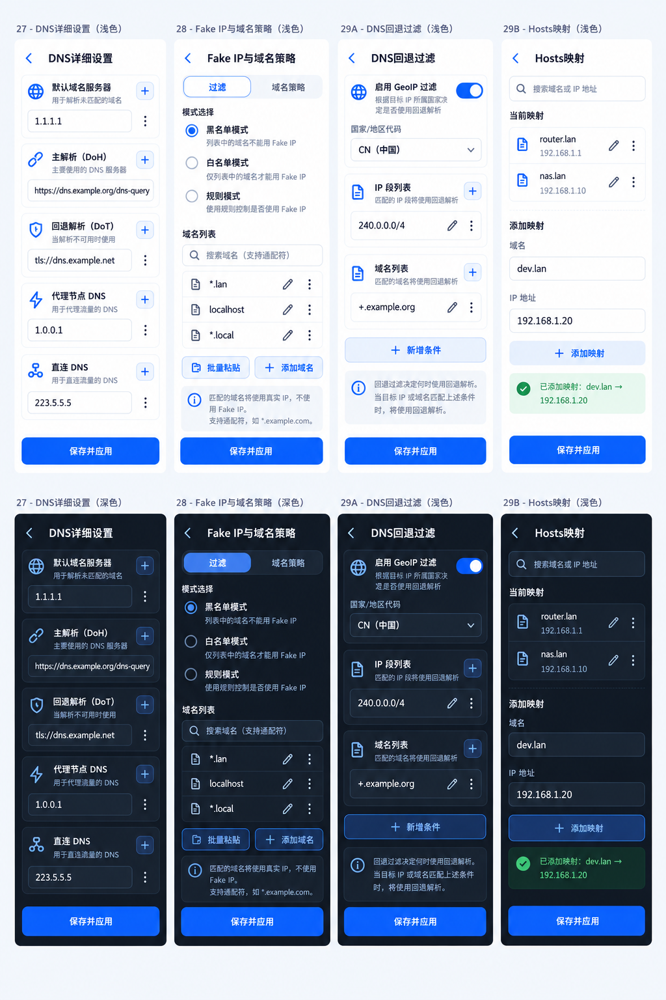
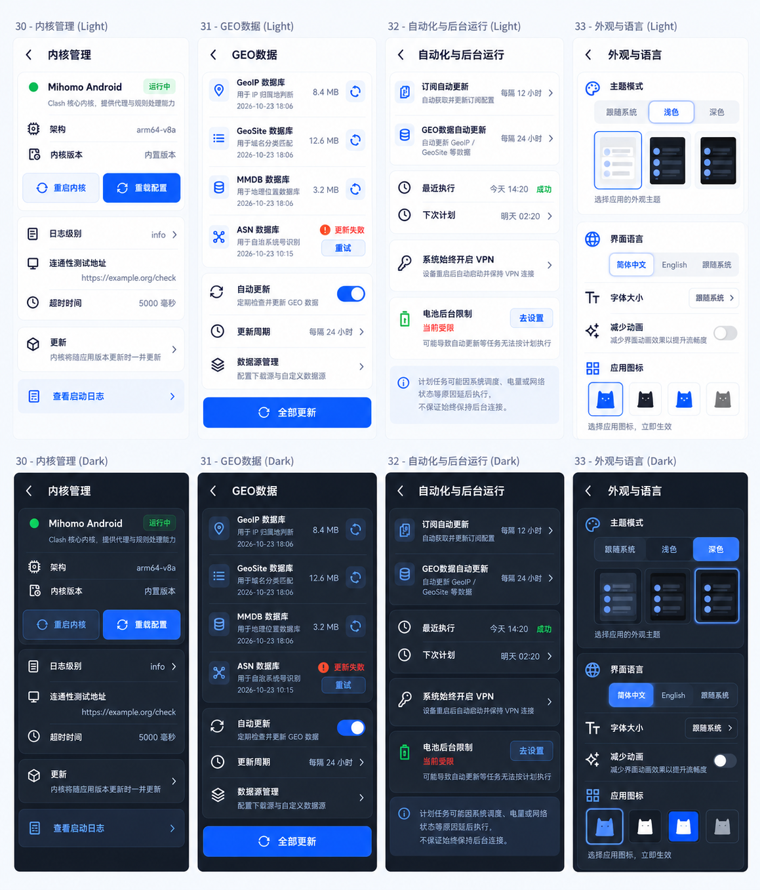
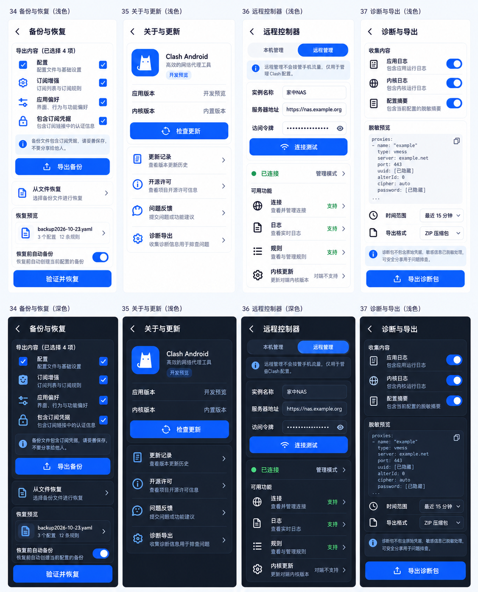

# Clash Android · 第2组风格 · 二级页面

本轮延续用户选定的第2组。8张专题画板，每张上排4个浅色页面，下排对应4个深色页面，合计32个页面、64个主题画面。各画板按同一页面编号对应，属于静态视觉设计，不是已运行的Android界面。

[原始页面规格](../android-ui.md) · [选定主页面](../direction-2.png) · [完整生成提示集](prompts.md) · [主题与交互规范](theme-and-states.md)

## 页面索引

| 画板 | 页面编号 | 内容 |
|---|---|---|
| [开始使用与代理编辑](01-proxies.png) | 01、04、05、06 | 开始使用与代理编辑 |
| [订阅配置与规则入口](02-profiles.png) | 08、09、10、11 | 订阅配置与规则入口 |
| [规则管理与覆写](03-rules.png) | 12、13、14、15 | 规则管理与覆写 |
| [编辑器与连接详情](04-editors.png) | 16、17、18、20 | 编辑器与连接详情 |
| [VPN与网络](05-vpn-network.png) | 23、24、25、26 | VPN与网络 |
| [DNS详细设置](06-dns.png) | 27、28、29A、29B | DNS详细设置 |
| [内核、自动化与外观](07-runtime.png) | 30、31、32、33 | 内核、自动化与外观 |
| [备份、远程与诊断](08-maintenance.png) | 34、35、36、37 | 备份、远程与诊断 |

原规格29拆为29A回退过滤、29B Hosts，新增37诊断导出。01为首次使用，虽非传统二级页，也纳入完整覆盖。原规格02/03/07/19/21/22为上一轮已有的主页面或主页面标签，本轮不重复绘制。

## 开始使用与代理编辑

## 订阅配置与规则入口

## 规则管理与覆写

## 编辑器与连接详情

## VPN与网络

## DNS详细设置

## 内核、自动化与外观

## 备份、远程与诊断

## 使用边界

图片中的域名、凭据、日期、版本与流量均为演示数据。表单长内容滚动，复杂编辑器独占页面；不得把压缩画板中的文字大小直接当成实现字号。开发时以主题与交互规范、原始页面规格为准。图稿出现的文字细节和控件数量需复核，不将图像生成结果当作平台行为或API支持的证据。

### 已发现的图稿文字差异

- 部分下排外部图注误写“浅色”，下排页面本身均是深色，按“上浅下深”查看。
- 16脚本页作用范围应为“全局／当前订阅”，订阅名“日常订阅”独立显示；画面生成结果把名称放进了选项，实施时按此纠正。
- 28“模式选择”存在生成错字；33浅色图第三个主题标签应为“深色”。
- 11列表中的策略值用于显示；真正编辑经规则编辑页保存，不因图中类似下拉框的外观引入未经确认的即时修改。
- 13不支持规则的示例仅展示警告结构，不是解析器支持格式的权威清单。15的最小覆写仅演示编辑布局，实际字段以当前内核和配置校验为准。

本轮已复查全部最终画板：每张四个浅色、四个深色，返回栏和底部操作无画布裁切。功能与可访问性仍需在Android实现阶段验证。

