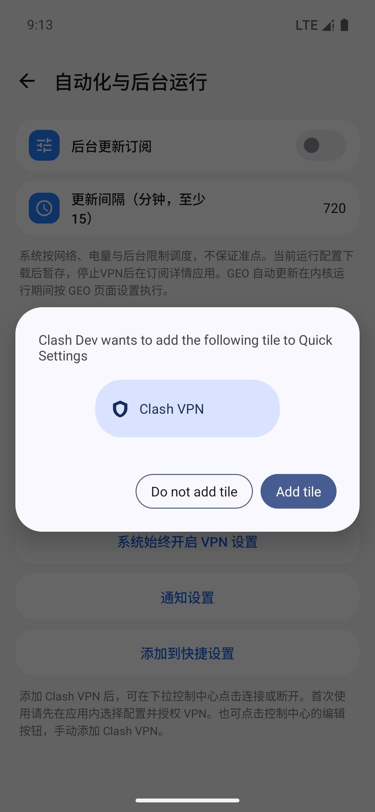

# Android 快捷设置开关验证（0.2.15-dev）

2026-10-24，本地 Android 16 / API 36 ARM64 独立模拟器。

- `assembleDebug`、`lintDebug`、`testDebugUnitTest` 通过。
- `TileIntegrationTest` 两项测试通过：自动化页面打开系统添加确认面板；系统磁贴启动/停止真实本地 VPN 服务，并验证运行期内核操作。
- 磁贴使用单色盾牌图标、连接状态副标题及系统开关语义。首次需在应用中选择配置并授权 VPN。
- Android 13+ 请求系统添加面板；较早系统或不支持直接添加的系统显示手动添加说明。
- 原模拟器同时有其他开发任务活动，复测存在界面定位、进程中断等干扰，最终改用独立 emulator-5562 验证。
- 同工作区并行界面变更出现两处编译兼容问题，做了最小修复：移除 `Transition.AnimatedContent` 不支持的 `label` 参数；测试中的 `ProxyToolbar` 使用命名 `go` 参数。
- 尚未在用户手机控制中心验证；厂商系统最终外观由系统决定。

入口：设置 → 自动化与后台 → 添加到快捷设置。也可在控制中心编辑界面手动添加 Clash VPN。

系统添加面板：

